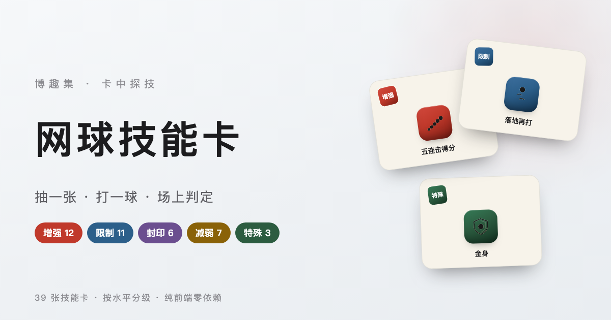
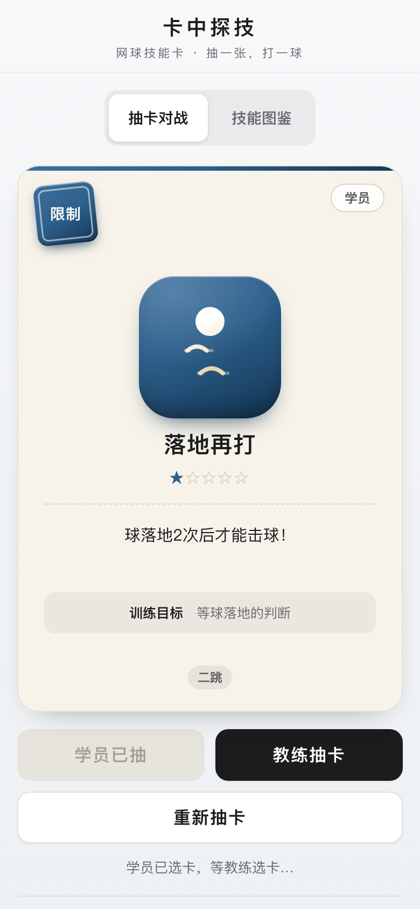
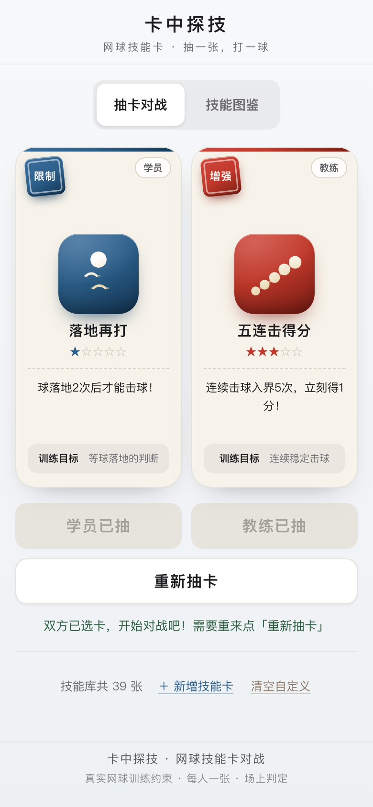
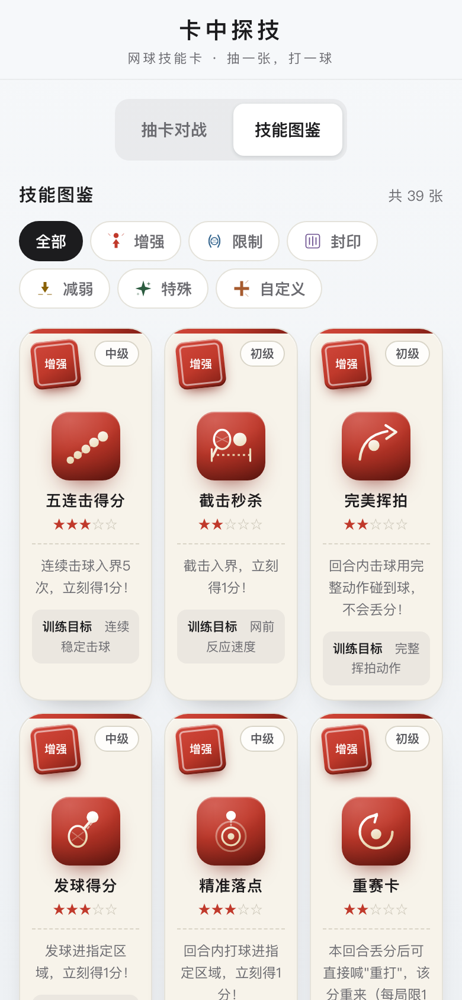

# 卡中探技 · 网球技能卡对战

> 抽一张网球技能卡，把真实的训练约束变成场上的一分。

[](LICENSE)
[](index.html)
[](index.html)

<p align="center">
  
</p>

**在线体验**：<https://tenniscoachli.github.io/tennis-card-duel/>

---

## 截图

| 抽卡 | 双人对战 | 技能图鉴 |
|:---:|:---:|:---:|
|  |  |  |

---

## 这是什么

网球场上最难的从来不是「把球打过去」，而是**在正确的时机做正确的动作**。
所以我把训练拆成了一张张**技能卡**：每张卡只对应一个真实的技术目标，
写成一条**场边的人一眼能判定**的规则 —— 不用看数据面板，只看真人动作。

比赛开始前，两边各抽一张卡，这一分的规则就由卡决定。

### 39 张内置卡 · 5 大类别

| 类别 | 数量 | 印色 | 意思 |
|---|:--:|---|---|
| **增强** | 12 | 朱砂红 `#c0392b` | 做到就得分 / 加成的挑战 |
| **限制** | 11 | 石青 `#2c5f8a` | 给自己加约束 |
| **封印** | 6 | 墨紫 `#6b4e8f` | 限制对手某项技术 |
| **减弱** | 7 | 深藤黄 `#8a6208` | 对手做到某动作就减分 |
| **特殊** | 3 | 石绿 `#2c5c40` | 改变流程的趣味卡 |

每张卡还带 **1~4 星难度**（零基础 / 初级 / 中级 / 进阶）和一句**训练目标**，
教练可以按球员水平发牌。

### 怎么玩

1. **抽卡** —— 学员、教练各点一次，各得一张（点卡面可放大细看）
2. **对局** —— 这一分按两张卡的规则来打，场边判定
3. **重抽** —— 「重新抽卡」重置双方；「清空自定义」只删自建卡，内置卡不受影响

### 自己造卡 + 重复检测

「＋ 新增技能卡」可以创建自己的技能：名称 / 分类 / 难度 / **机制标签** / 规则 / 训练目标，
再从 **45 个图标**里挑一个卡面图标（按分类着色）。

**机制标签**是这个页面防重复的关键。选完标签会实时跟已有卡比对，
发现机制相近的就提醒你：

| 提示 | 含义 |
|---|---|
| ⚠️ 有卡的机制和这张完全一样 | 标签完全重合，多半是同一件事 |
| 可能与已有的卡重复 | 机制有重叠，规则可能不同 —— 你自己判断 |

标签分四个维度：**动作**（正手/反手/截击/发球…）、**约束**（二跳/指定区域/连续…）、
**对象**（自己/对手）、**结果**（得分/减分/失误/免罚）。
39 张内置卡都标了标签，完整对照见 [标签体系.md](标签体系.md)。

> 为什么不靠「AI 判断相似」？实测过三种文本相似度算法，误报率高到用户会直接关掉功能
> —— 比如「二跳正手」和「二跳击球」是两张不同的内置卡，字符相似度却高达 0.50。
> 标签是**可预期**的：同样选了「二跳」+「正手」，规则上就真的重合。

自建卡存在浏览器 localStorage 里，不上传任何服务器。

---

## 几个设计上的决定

### 1. 图标：一卡一手势，绝不只换色

39 张卡各有**一张专属手绘图标**。参考了《魔兽世界》的技能图标系统 ——
它最重要的经验是：**「同一个图标换个颜色」是最糟的做法**
（早期萨满的治疗之潮和灵魂链接就是这样，玩家根本分不出来）。
所以同分类内的 12 张卡用**完全不同的设计语言**：五连击是 5 个递进球、
精准落点是靶心、上旋高球是螺旋、重赛卡是循环箭头。

分类徽记则用**形状编码**（借鉴《杀戮尖塔》「图标边框形状代表卡牌类型」）：

| 增强 | 限制 | 封印 | 减弱 | 特殊 | 自定义 |
|:---:|:---:|:---:|:---:|:---:|:---:|
| 向上箭头 | 双括号 | 印章 | 向下箭头 | 四芒星 | 十字 |

### 2. 染色：CSS mask 让印色透出形状

图标本身是纯 SVG 线条，用 **CSS `mask-image`** 当作形状模板，颜色完全交给 CSS：

```css
.icon-mask {
  background: linear-gradient(155deg, #fffdf6, #ffffff 32%, #e7d4ac 66%, #fffaf0);
  mask-image: var(--icon);   /* url("icons/skill-xxx.svg") */
  mask-size: contain;
}
```

于是：**深色印石底砖 + 金属渐变图标 + 印石质感印章**，
抽到卡的第一眼，不用读字就知道是哪一类。

### 3. 动效

牌从牌堆飞入 → 光掠过卡面 → 图标弹入 → 文字依次浮现 → 光点迸出，
再配一套按分类区分的 Web Audio 音效（不加载任何音频文件）。
全部包在 `@media (prefers-reduced-motion: reduce)` 里，动效敏感的用户自动关闭。

### 4. 无障碍

- 正文与背景对比度全部 ≥ 4.5:1（脚本实测）
- 所有可交互元素 ≥ 44×44px
- 表单控件全部 `<label for>` 关联
- 焦点环可见（`:focus-visible`）
- 分类靠**颜色 + 形状 + 文字**三重编码，不单靠颜色
- 允许双指缩放（不禁止 pinch zoom）
- 尊重 `prefers-reduced-motion`

---

## 本地运行

纯静态，**零依赖、零构建**：

```bash
# 任选其一
python3 -m http.server 8000
npx serve .
```

然后打开 <http://localhost:8000>。

> 也可以直接双击 `index.html` 打开。
> 45 个图标都以 **data URI 内嵌在 HTML 里**（`ICON_URI`），
> 所以 `file://` 协议下同样能正常显示 —— 不会因为浏览器拦截外部
> `mask-image` 而只看到空底砖。

### 在手机上测试

**方式一：局域网访问（推荐，能测到真机触感和真机 Safari）**

```bash
# 启动时绑定 0.0.0.0，手机就能连
python3 -m http.server 8000 --bind 0.0.0.0
```

查本机 IP（macOS）：

```bash
ipconfig getifaddr en0
```

手机连同一个 WiFi，浏览器打开 `http://<那个IP>:8000/`。

**方式二：手机预览对照页**

打开 <http://localhost:8000/手机预览.html>，三个 iPhone 宽度并排显示
（iPhone SE 375 / iPhone 14 390 / iPhone 14 Pro Max 430）。

> 为什么要专门做这个页：Chrome 桌面版**强制最小 500px 视口**，
> 把窗口拖窄只会裁切，不会真的变成 390px —— 所以桌面窗口模拟不出真实手机宽度。
> 这个页面用 iframe 承载真实设备宽度，是唯一准确的办法。

**建议重点测这几项**（我这边只能做静态渲染，测不了的）：

| 测什么 | 怎么看 |
|---|---|
| 抽卡动效节奏 | 0.52s 飞入 + 0.74s 扫光，觉得快/慢告诉我调 |
| 点击卡片放大 | 之前有错位 bug，已改成独立遮罩层，重点确认不再重叠 |
| 音效 | 5 个分类各有音型，需用户手势后才响（浏览器策略） |
| 拇指操作 | 抽卡按钮、图标选择器在真机上是否够好按 |
| 双指缩放 | 页面允许缩放（没有禁掉），确认手势正常 |

---

## 项目结构

```
.
├── index.html          # 全部内容（HTML + CSS + JS 内联，单文件 72KB）
├── icons/              # 46 个 SVG：6 个分类徽记 + 39 张功能图标 + favicon
├── screenshots/        # README 用截图
├── og-cover.png        # 社交分享封面
├── .github/workflows/
│   └── pages.yml       # GitHub Pages 自动部署
├── deploy.sh           # 一键建仓 + 推送 + 开 Pages
└── LICENSE             # MIT
```

---

## 致谢与来源

本项目是**「博趣集」**（`mysite_new`）里网球技能卡页面的独立重构版。

- 卡牌规则与训练目标的设计原则来自网球教学中「**真实可执行**」的要求：
  每条规则必须场上可观察、可判定，一句话说清，不使用电脑游戏式的虚拟数值
- 图标系统参考了《魔兽世界》技能图标与《杀戮尖塔》卡牌 UI 的设计方法论
- 页面外壳与「博趣集」其它页面（回位理念、网球统计）保持同一套设计语言

---

## License

[MIT](LICENSE) © 2026 TennisCoachLi
